# Manual de usuario – LivesManage

LivesManage reemplaza el cuaderno de los lives de TikTok. Durante el live se anota quién compra y cuánto; después se cobra, se cierra el live y, en la ficha de cada clienta, se registran sus bolsas y su forma de entrega.

Este manual es para las dos personas que usan la app:

- **Vendedora:** anota durante el live, cobra, cierra y registra bolsas y entregas.
- **Administradora (Admin):** todo lo anterior, y además crea usuarios, reabre lives cerrados, desactiva clientas y cambia los días de inactividad.

Las imágenes son de la versión de celular, que es la que se usa durante el live. En el computador las mismas pantallas usan más columnas y tablas, y todo se maneja con mouse y teclado (Enter para enviar).

## Contenido

1. [Entrar a la app](#1-entrar-a-la-app)
2. [Lives](#2-lives)
3. [Anotar durante el live](#3-anotar-durante-el-live)
4. [Corregir y cobrar](#4-corregir-y-cobrar)
5. [Terminar el live y cerrarlo](#5-terminar-el-live-y-cerrarlo)
6. [Clientas](#6-clientas)
7. [Bolsas y entrega](#7-bolsas-y-entrega)
8. [Estadísticas](#8-estadísticas)
9. [Usuarios (solo Admin)](#9-usuarios-solo-admin)
10. [Problemas frecuentes](#10-problemas-frecuentes)

## 1. Entrar a la app

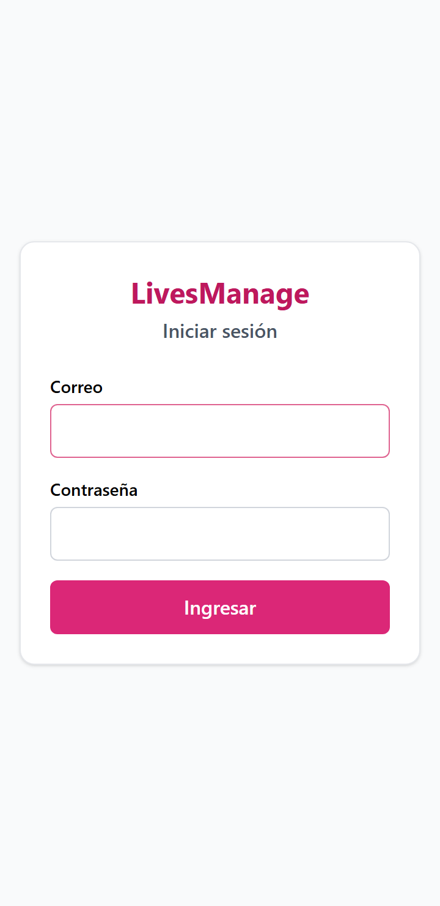

1. Abre la dirección de la app en el navegador del celular o del computador.
2. Escribe tu correo y tu contraseña, y toca **Ingresar**.
3. Si los datos no son correctos, la app muestra un mensaje general, sin decir cuál de los dos falló.

La sesión dura 8 horas, suficiente para un live y su cierre. Para salir, abre el menú y toca **Cerrar sesión**.

**Cambiar tu contraseña:** en el menú, toca **Cambiar mi contraseña**, escribe la actual y dos veces la nueva (al menos 8 caracteres). La próxima vez que entres usa la nueva.

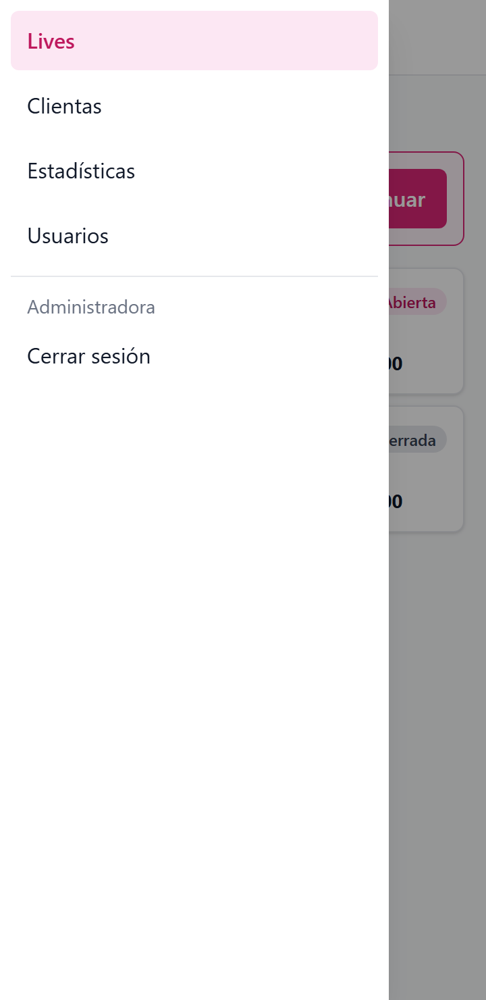

El menú (☰, arriba a la izquierda) lleva a **Lives**, **Clientas**, **Estadísticas** y, para la Admin, **Usuarios**. En el computador el menú queda fijo a la izquierda.

## 2. Lives

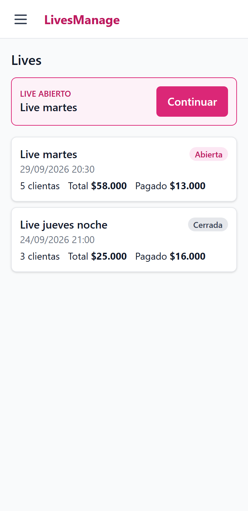

La pantalla **Lives** muestra cada live con su fecha, estado, número de clientas, total y lo pagado.

- **Abrir live:** toca **Abrir live**, escribe un nombre si quieres (por ejemplo "Live jueves noche") y confirma.
- **Solo puede haber un live Abierto.** Si ya hay uno, el botón dice **Continuar** y te lleva a él.
- **Estados de un live:**
  - **Abierta:** se anotan compras.
  - **En cierre:** el live terminó; se cobra.
  - **Cerrada:** queda de solo lectura, salvo las bolsas y la entrega de cada clienta.

## 3. Anotar durante el live

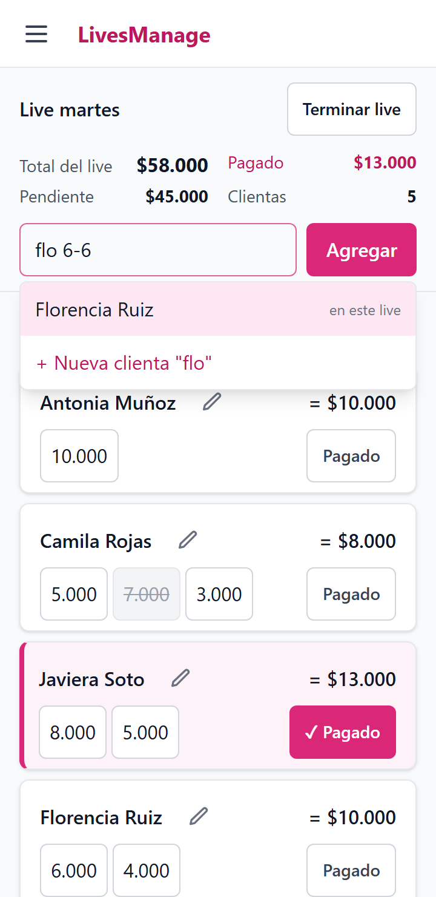

Arriba se ven siempre los totales del live (total, pagado, pendiente y clientas) y el campo de anotación. Debajo está la hoja, con una línea por clienta.

**Cómo se escribe una compra:** el nombre de la clienta y después los precios.

| Escribes | Se anota |
| --- | --- |
| `flo 6000 4000` | Dos prendas de $6.000 y $4.000 |
| `flo 6000-4000` | Lo mismo: los precios se separan con espacio o guion |
| `flo 6.000 3.500` | $6.000 y $3.500 (acepta punto de miles) |
| `flo 6-6-5` | En miles, unidos con guion: $6.000, $6.000 y $5.000 |
| `flo 6-2500` | Se pueden mezclar: $6.000 y $2.500 |
| `Cami 2 6000` | $6.000 para la clienta "Cami 2" |

Reglas:

- Cada precio va de $1.000 a $999.000, en múltiplos de $100.
- Un número corto **sin guion** es parte del nombre ("Cami 2"). Para anotar en miles hay que unirlos con guion.
- Mientras escribes, aparecen sugerencias de clientas. La destacada (en rosado) es la que se usa al presionar **Enter** o **Agregar**. Para elegir otra, tócala. "Nueva clienta" crea una ficha con el nombre tal como lo escribiste.
- Si la clienta ya tiene línea en este live, las prendas se suman a esa línea. Si no, se crea una línea nueva.

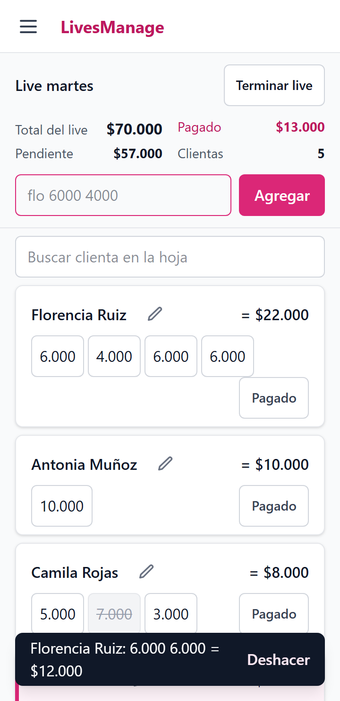

Al guardar, la línea sube al primer lugar de la hoja y aparece un aviso con lo anotado (por ejemplo "Florencia Ruiz: 6.000 6.000 = $12.000") y el botón **Deshacer**, por si te equivocaste.

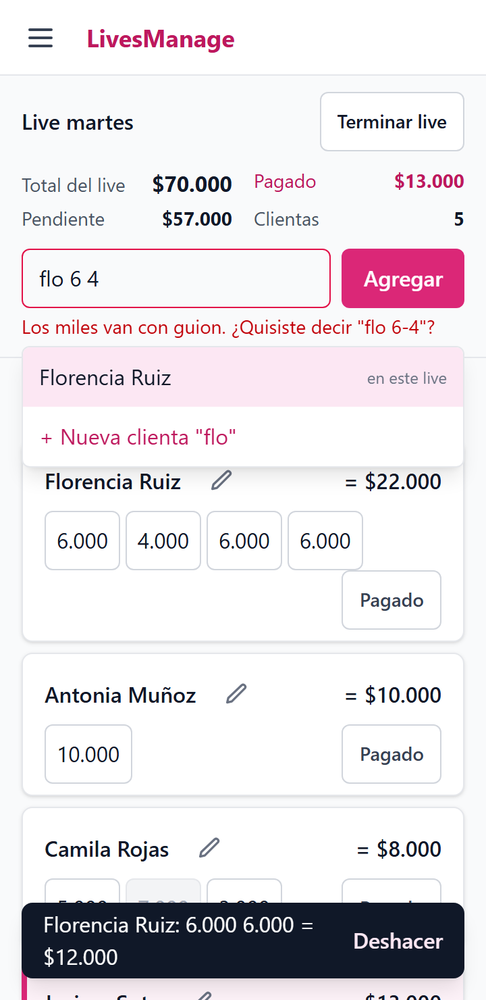

Si el texto tiene un error, no se guarda nada, aparece el problema en rojo y el texto se conserva para corregirlo. Por ejemplo, `flo 6 4` (miles sin guion) pregunta: *¿Quisiste decir "flo 6-4"?*. Así no se crea por error una clienta llamada "flo 6".

### Agregar prendas con el lápiz

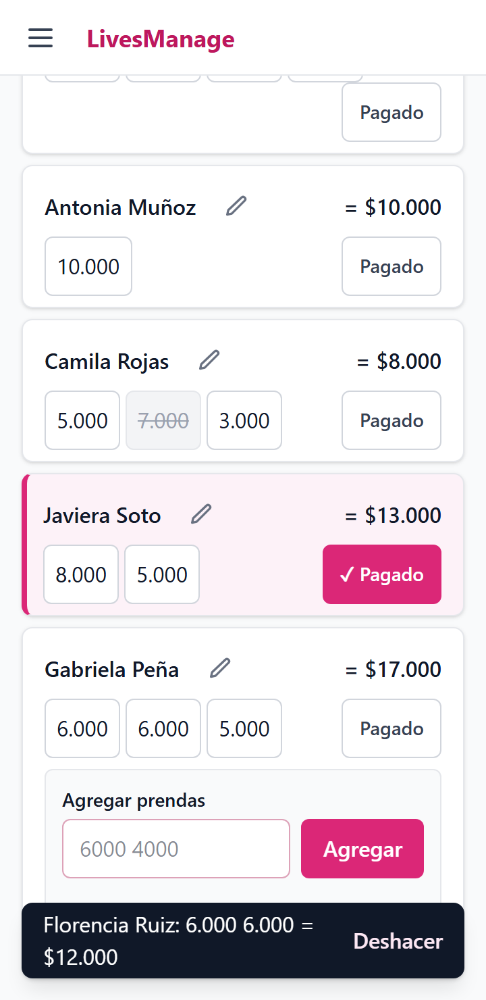

El lápiz ✎ junto al nombre abre un panel para sumar prendas a esa clienta **sin escribir su nombre**. Basta con los precios: `6000 4000`, `6-4` o `6 4` (en el lápiz los miles valen con o sin guion). Funciona con el live Abierto y también En cierre.

En el mismo panel está **Cambiar clienta**, para cuando la línea quedó a nombre de otra persona. Si la clienta correcta ya tenía línea en el live, la app pide confirmar y une las dos líneas.

## 4. Corregir y cobrar

- **Cancelar una prenda:** toca el precio. Queda tachado y el total baja. Tócalo otra vez para restaurarlo. Las prendas nunca se borran.
- **Pagado:** toca **Pagado** en la línea cuando la clienta pague. La línea se pone rosada y sube el total pagado. Tócalo de nuevo para deshacerlo.
- Si a una línea Pagada le agregas o restauras una prenda, vuelve a quedar Pendiente, porque hay un monto nuevo por cobrar.
- **Buscar en la hoja:** el campo "Buscar clienta en la hoja" filtra las líneas por nombre.

## 5. Terminar el live y cerrarlo

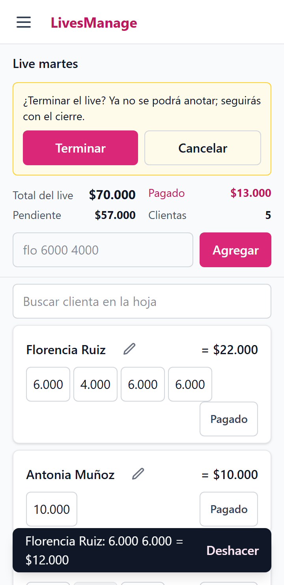

Cuando termina la transmisión, toca **Terminar live** y confirma. El campo de anotación desaparece y se abre la pantalla de cierre. Desde ese momento ya se puede abrir otro live.

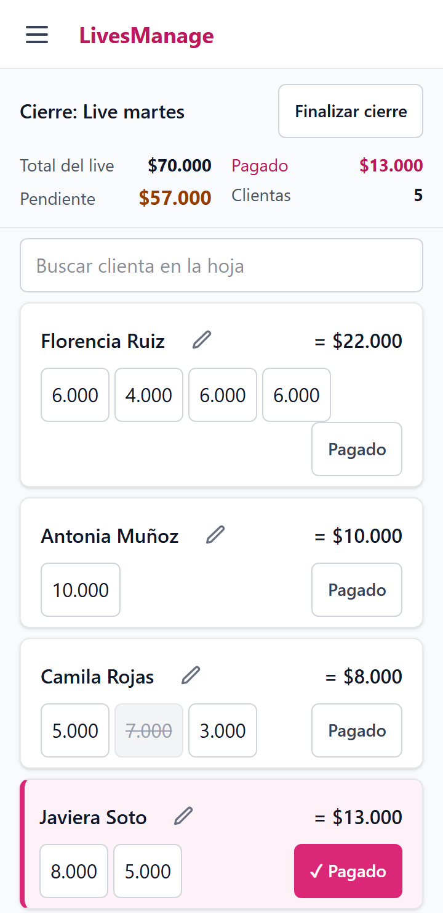

En el cierre se cobra: cada línea tiene sus prendas, el lápiz y el botón **Pagado**. El cierre puede quedar abierto varios días si se espera algún pago.

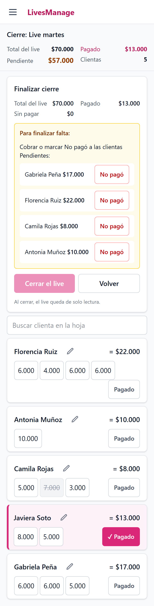

Para terminar:

1. Toca **Finalizar cierre**. Aparece un resumen con el total del live, lo pagado y lo que quedó sin pagar.
2. Si quedan clientas Pendientes, aparecen en la lista "Para finalizar falta". A las que no pagaron, toca **No pagó**. Si después pagan, toca **Deshacer** en su línea.
3. Cuando no queden Pendientes, se habilita **Cerrar el live**. Al confirmar, el live queda Cerrado y de solo lectura.

Solo la Admin puede **Reabrir cierre** de un live Cerrado; el live vuelve a En cierre con todo como estaba.

Las bolsas y la forma de entrega **no** se piden en el cierre: se registran en la ficha de cada clienta (sección 7).

## 6. Clientas

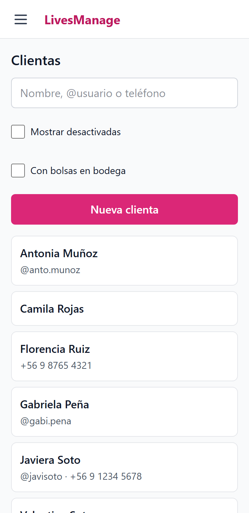

- **Buscar:** por nombre, usuario de TikTok o teléfono.
- **Nueva clienta:** solo el nombre es obligatorio. Si el usuario de TikTok o el teléfono ya es de otra clienta, la app avisa y deja guardar igual.
- **Mostrar desactivadas:** muestra también las clientas dadas de baja.
- **Con bolsas en bodega:** muestra solo a quienes tienen bolsas sin entregar (sección 7).

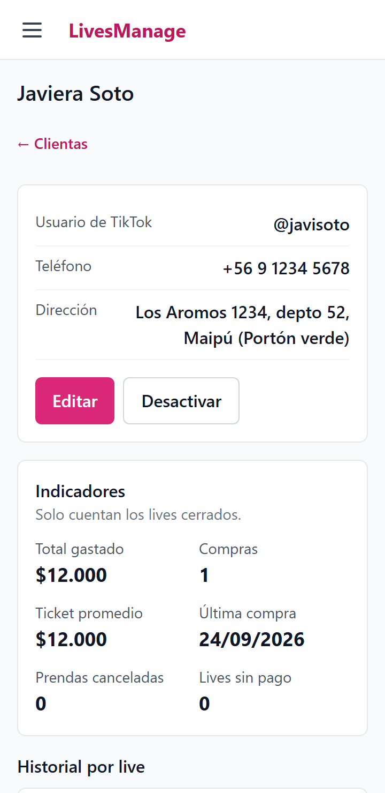

La **ficha** de una clienta tiene:

- Sus datos de contacto y dirección, con el botón **Editar**. Si le cambias el nombre, también cambia en sus líneas de todos los lives.
- **Indicadores:** total gastado, compras, ticket promedio, última compra, prendas canceladas y lives sin pago. Solo cuentan los lives Cerrados.
- **Historial por live:** fecha, prendas, total, pago y entrega de cada compra. Tocar la fecha abre ese live.
- **Desactivar / Reactivar (solo Admin):** una clienta desactivada conserva su historial, pero no aparece al anotar.

## 7. Bolsas y entrega

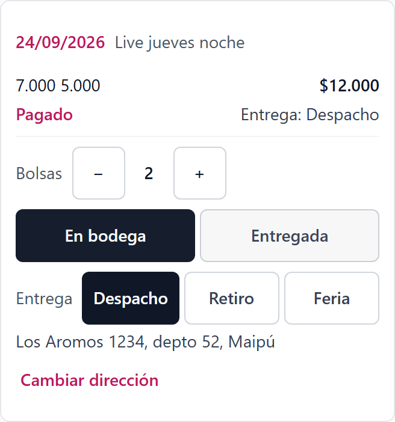

En el historial de la ficha, cada compra de un live En cierre o Cerrado permite registrar:

- **Bolsas:** con − y + indicas cuántas bolsas se armaron para esa compra.
- **En bodega / Entregada:** si las bolsas siguen en la tienda o ya se entregaron. Se puede elegir cuando hay al menos una bolsa.
- **Entrega:** Despacho, Retiro o Feria.
  - **Retiro** y **Feria** se guardan con un toque.
  - **Despacho** necesita una dirección. Puedes usar la de su ficha, o escribir otra, que queda guardada en la ficha.

Esto se puede hacer aunque el live ya esté Cerrado, porque las bolsas suelen entregarse días después.

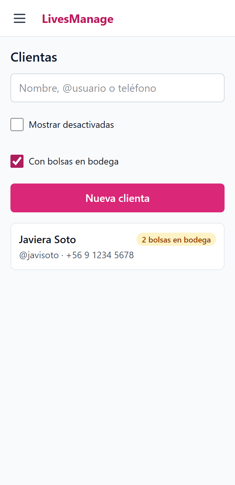

En **Clientas**, marca **Con bolsas en bodega** para ver a quién le falta entregar y cuántas bolsas tiene cada una.

## 8. Estadísticas

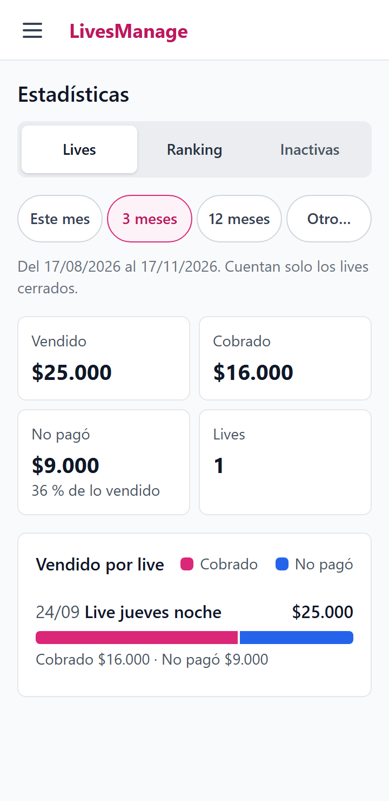

Arriba eliges el período: este mes, 3 meses (por defecto), 12 meses u **Otro…** para elegir fechas. Solo cuentan los lives Cerrados.

- **Lives:** vendido, cobrado, no pagado y número de lives, más el gráfico "Vendido por live".

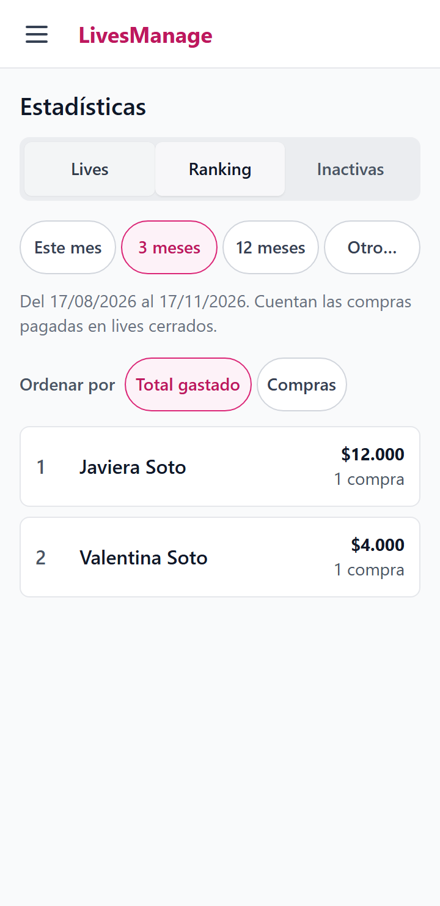

- **Ranking:** las clientas ordenadas por total gastado o por número de compras en el período.

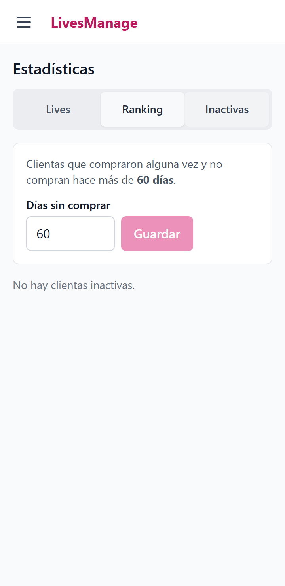

- **Inactivas:** clientas que no compran hace más de 60 días, con los días sin comprar y sus contactos (TikTok, teléfono y WhatsApp) para invitarlas al próximo live. La Admin puede cambiar los días.

## 9. Usuarios (solo Admin)

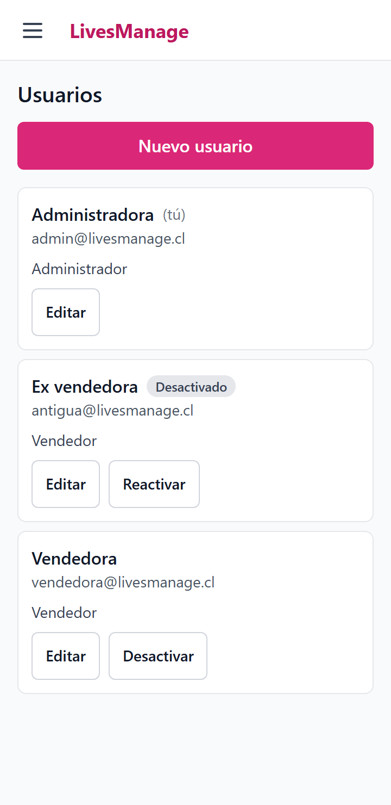

- **Nuevo usuario:** nombre, correo, rol (Administrador o Vendedor) y una contraseña inicial de al menos 8 caracteres.
- **Editar:** cambia nombre, correo o rol.
- **Contraseña:** si alguien olvidó su contraseña, toca **Contraseña** en su fila, escribe una nueva y entrégasela. Tu propia contraseña se cambia desde el menú, con **Cambiar mi contraseña**.
- **Desactivar / Reactivar:** un usuario desactivado ya no puede entrar.
- Nadie puede desactivarse ni cambiarse el rol a sí mismo.

La vendedora no ve esta pantalla. Si entra a la dirección directamente, la app le avisa que no tiene permiso.

## 10. Problemas frecuentes

| Qué pasa | Qué hacer |
| --- | --- |
| "No se pudo conectar con el servidor" | Revisa tu conexión a internet. Si sigue, avisa a quien administra la app. Lo que escribiste en el campo de anotación no se pierde. |
| La app vuelve a pedir la contraseña | La sesión dura 8 horas. Vuelve a entrar. |
| La vendedora olvidó su contraseña | La Admin la restablece en **Usuarios** → **Contraseña**. |
| "Demasiados intentos" al entrar | Hubo 10 contraseñas mal escritas seguidas. Espera unos minutos. |
| Anoté a la clienta equivocada | Toca **Deshacer** en el aviso, o usa el lápiz → **Cambiar clienta**. |
| Una prenda se anotó de más | Toca el precio para cancelarlo. |
| No puedo cerrar el live | Quedan clientas Pendientes: cóbralas o márcalas **No pagó**. |
| Un live Cerrado tiene un error | Solo la Admin puede **Reabrir cierre**. |
