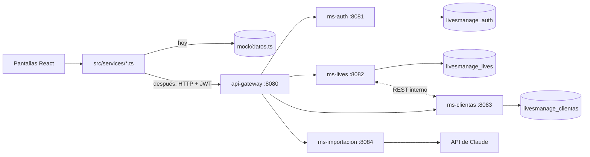

# Plan del backend – LivesManage

Guía para construir el backend y conectarlo con el frontend que ya existe. Fuente de verdad: `docs/ERS.md` y `docs/decisiones.md`. Se trabaja un paso por sesión, con OK antes de escribir código.

## 1. La idea en una imagen

Hoy el frontend funciona con datos simulados: cada archivo de `frontend/src/services/` responde con datos de `services/mock/datos.ts`. El backend reemplaza esos datos simulados por datos reales guardados en MySQL. **Las pantallas no cambian**: solo cambia el interior de los servicios.



- El frontend **solo** conoce el gateway (`http://localhost:8080/api/...`).
- El gateway revisa que el token sea válido y reenvía la petición al microservicio que corresponde según la ruta (`/api/auth/**` → ms-auth, `/api/sesiones/**` → ms-lives, etc.).
- Cada microservicio tiene su propia base y no lee las tablas de otro. Si necesita un dato ajeno, lo pide por REST.

## 2. Paso 0: instalar herramientas (una vez)

Hoy el computador no tiene ninguna de estas herramientas.

| Herramienta | Para qué | Cómo |
| --- | --- | --- |
| JDK 21 (Temurin, LTS) | Compilar y correr Spring Boot (el ERS pide Java 17 o superior, RNF-27) | `winget install EclipseAdoptium.Temurin.21.JDK` |
| MySQL 8 (Community Server) | Las cuatro bases de datos | `winget install Oracle.MySQL` o el instalador de mysql.com, y después crear las bases |
| Maven | No se instala | Cada servicio trae `mvnw` (Maven wrapper) |
| Extensión "Extension Pack for Java" de VS Code | Ejecutar y depurar desde el editor | Marketplace de VS Code |

Spring Boot: la versión estable más reciente que ofrezca start.spring.io al crear el primer servicio, con la versión de Spring Cloud que le corresponde (para el gateway). Todos los servicios usan la misma versión.

## 3. Cómo se arma cada microservicio

Todos siguen la misma estructura (RNF-20), así que basta entender uno:

```
ms-xxx/
  src/main/java/cl/livesmanage/xxx/
    controller/   recibe la petición HTTP, valida el DTO (@Valid) y responde (ResponseEntity)
    service/      reglas del negocio (aquí van las reglas de docs/decisiones.md), transacciones
    repository/   acceso a MySQL con Spring Data JPA (sin SQL escrito a mano)
    model/        entidades JPA (tablas). Nunca salen de la API
    dto/          lo que entra y sale por la API, con la misma forma que los tipos de frontend/src/types/
    exception/    @RestControllerAdvice: convierte errores en mensajes comprensibles (RNF-14)
    config/       seguridad (JWT y roles), Swagger, WebClient
  src/main/resources/application.yml   configuración; secretos solo por variables de entorno (RNF-26)
  src/test/java/...                     JUnit + Mockito
```

### Ejemplo de punta a punta: anotar "flo 6-4"

1. **Pantalla de live** (`LivePage` → `CampoAnotacion`): el parser del front convierte el texto en `{ nombre: "flo", precios: [6000, 4000] }` y llama a `anotar()`.
2. **`sesionesService.anotar()`**: hoy modifica el mock. Con backend hace `POST /api/sesiones/{id}/anotaciones` con el token en `Authorization: Bearer ...`.
3. **api-gateway**: valida el token y reenvía la petición a ms-lives.
4. **ms-lives / `AnotacionController`**: valida el cuerpo (precios entre $1.000 y $999.000, enteros).
5. **`AnotacionService`** (en una sola transacción, RNF-12): revisa que la sesión esté Abierta, busca la línea de esa clienta o crea una, agrega las prendas, vuelve la línea a Pendiente si estaba Pagada (D-20) y guarda quién anotó y cuándo (RNF-09).
6. **Respuesta**: `{ anotacionId, linea }`, la misma forma que hoy devuelve el mock. La pantalla muestra el aviso con Deshacer sin enterarse de que ahora los datos son reales.

## 4. Los microservicios, uno por uno

En cada tabla, la columna "Función del front" indica qué función de `frontend/src/services/` pasa a usar ese endpoint. Los contratos exactos (cuerpos, códigos de error) se definen y se anotan como decisión al empezar cada servicio.

### 4.1 ms-auth (:8081): usuarios y login — RF-01, RF-03

Tabla `usuario`: id, nombre, correo (único), contrasena_hash (BCrypt, RNF-05), rol (ADMIN/VENDEDOR), activo.

| Endpoint | Función del front | Pantalla | Quién |
| --- | --- | --- | --- |
| `POST /api/auth/login` (D-31) | `iniciarSesion` | Login | Público |
| `GET /api/auth/yo` | `usuarioActual` | Layout (nombre y rol) | Conectado |
| `GET /api/usuarios` | nueva | Usuarios (RF-03) | Admin |
| `POST /api/usuarios` | nueva | Usuarios | Admin |
| `PUT /api/usuarios/{id}` | nueva | Usuarios | Admin |
| `PATCH /api/usuarios/{id}/activo` | nueva | Usuarios | Admin |

- El login entrega un **JWT** firmado que dura 8 horas (RNF-06) y lleva el id, el nombre y el rol del usuario.
- Un usuario desactivado recibe el mismo 401 que una contraseña mala (D-31).
- Al partir, si la base no tiene usuarios, se crea una Admin inicial con correo y contraseña tomados de variables de entorno.

### 4.2 api-gateway (:8080) — RF-02, RNF-07

- No tiene base de datos. Rutas: `/api/auth/**` y `/api/usuarios/**` → ms-auth; `/api/sesiones/**` y `/api/compras/**` → ms-lives; `/api/clientas/**` y `/api/configuracion/**` → ms-clientas; `/api/importaciones/**` → ms-importacion.
- Valida el JWT en todas las rutas salvo el login. Sin token o con un token vencido responde 401.
- Configura **CORS** para que el navegador acepte las respuestas del front (`localhost:5173` y la URL de GitHub Pages).
- Además, cada microservicio vuelve a revisar el rol (RNF-07): una Vendedora que llama directo a `/api/usuarios` recibe 403. Para eso todos comparten la clave del JWT (`JWT_SECRET`, por variable de entorno).

### 4.3 ms-clientas (:8083): fichas y estadísticas — RF-12, RF-13, RF-14

Tablas: `clienta` (nombre, usuario_tiktok, telefono, activa), con la dirección en columnas (D-04), y `configuracion` (días de inactividad, 60 por defecto).

| Endpoint | Función del front | Pantalla |
| --- | --- | --- |
| `GET /api/clientas` | `listarClientas` | Clientas, sugerencias del live |
| `GET /api/clientas/{id}` | `obtenerClienta` | Ficha |
| `POST /api/clientas` | `crearClienta` | Nueva clienta |
| `PUT /api/clientas/{id}` | `actualizarClienta` | Editar ficha |
| `GET /api/clientas/duplicados?tiktok=&telefono=` | `buscarDuplicados` | Formulario (aviso D-28) |
| `PATCH /api/clientas/{id}/activa` | `cambiarActiva` | Ficha (Admin) |
| `GET /api/clientas/ranking?criterio=&desde=&hasta=` | `rankingClientas` | Estadísticas |
| `GET /api/clientas/inactivas` | `listarInactivas` | Estadísticas |
| `GET/PUT /api/configuracion/dias-inactividad` | `obtenerDiasInactividad` / `cambiarDiasInactividad` | Estadísticas (Admin) |

- Las reglas que hoy están en `frontend/src/utils/clientas.ts` (normalizar TikTok y teléfono, ranking, inactivas, indicadores) se pasan a Java en `ClientaService` y `EstadisticasService`, con sus pruebas JUnit.
- `ultimaCompra` (D-15), el ranking y las inactivas necesitan las compras, que viven en ms-lives: ms-clientas las pide con `GET /api/compras` (interno).

### 4.4 ms-lives (:8082): el corazón — RF-04 a RF-11

Tablas: `sesion`, `linea` (con copia de `clienta_nombre`, D-03), `prenda`, `anotacion` (para Deshacer y para saber quién anotó, D-11 y RNF-09) y `entrega`.

| Endpoint | Función del front | Pantalla |
| --- | --- | --- |
| `GET /api/sesiones` | `listarSesiones` | Lista de lives (totales calculados aquí, RNF-11) |
| `POST /api/sesiones` | `abrirSesion` | Abrir live (solo una Abierta) |
| `GET /api/sesiones/{id}` | `obtenerSesion` | Live y cierre |
| `POST /api/sesiones/{id}/anotaciones` | `anotar` | Live (RF-05) |
| `DELETE /api/anotaciones/{id}` | `deshacerAnotacion` | Aviso con Deshacer (D-22) |
| `PATCH .../lineas/{id}/prendas/{id}` | `alternarPrenda` | Live (RF-06) |
| `PATCH .../lineas/{id}/clienta` | `cambiarClienta` | Live (RF-06, D-19) |
| `PATCH .../lineas/{id}/pago` | `alternarPago` | Live (RF-07) |
| `POST /api/sesiones/{id}/terminar` | `terminarSesion` | Live (RF-09) |
| `PATCH .../lineas/{id}/bolsa` | `alternarBolsa` | Cierre |
| `PUT .../lineas/{id}/entrega` | `registrarEntrega` | Cierre (RF-10) |
| `PUT .../lineas/{id}/entrega/{entregaId}` | `agruparEntrega` | Cierre ("Enviar junto con") |
| `PATCH .../lineas/{id}/no-pago` | `marcarNoPago` | Finalizar cierre |
| `POST /api/sesiones/{id}/finalizar` | `finalizarCierre` | Finalizar cierre (transacción, RNF-12) |
| `POST /api/sesiones/{id}/reabrir` | `reabrirSesion` | Admin |
| `GET /api/compras?clientaId=` | `historialDeClienta` / `listarCompras` | Ficha y Estadísticas |

- Las reglas que hoy están en `sesionesService.ts` (mock), `utils/montos.ts` y `utils/cierre.ts` se pasan a Java: `totalesDeLineas` (D-23) y `revisarCierre` (D-27). Son las pruebas unitarias obligatorias del ERS (RNF-22: cobertura de al menos 60 %).
- Comunicación con ms-clientas:
  - Anotar a una **clienta nueva** ("flo" no existe): ms-lives le pide a ms-clientas que la cree y guarda el id que recibe.
  - Registrar un **despacho con dirección nueva**: ms-lives se la manda a ms-clientas para que quede en la ficha (D-26).
  - **Renombrar** una clienta: ms-clientas avisa a ms-lives para actualizar `clienta_nombre` en todas sus líneas (D-28).

### 4.5 ms-importacion (:8084): foto del cuaderno — RF-15 (al final)

Recibe la foto, la manda a la API de Claude y devuelve las anotaciones para revisarlas. La clave `ANTHROPIC_API_KEY` vive solo aquí (RNF-10) y la foto no se guarda después de procesarla. Se planifica en detalle cuando llegue su turno.

## 5. Qué cambia en el frontend

1. **Un cliente HTTP pequeño** en `src/services/` (con `fetch`, sin dependencias): agrega `VITE_API_URL` y el token, convierte errores en mensajes y, si recibe un 401, borra la sesión y lleva al login (pendiente de D-31).
2. **Cada función de servicio** cambia por dentro para hacer su petición a la API en vez de leer el mock. Su firma y lo que devuelve no cambian, así que ninguna pantalla se toca.
3. **Las pruebas de Vitest siguen con el mock**, para no depender del backend. Cómo elegir entre mock y API (por ejemplo, con `VITE_API_URL` vacío = mock) se decide al conectar el primer servicio.
4. **Playwright**: E2E contra el backend real cuando esté completo.
5. **GitHub Pages** solo publica el front. Para que funcione con el backend hay que desplegar el backend en algún servidor (se decide más adelante).

El front se puede seguir mejorando durante todo el proceso: mientras no cambie la forma de los datos, el backend no se entera.

## 6. Pruebas del backend

- **Unitarias (JUnit + Mockito)** sobre los services: totales, anotar, Deshacer, reglas de cierre, duplicados, login. Son las que exige el ERS.
- **De repositorio** con una base H2 en memoria, para no necesitar MySQL en las pruebas.
- **De controller** (`@WebMvcTest`): validación, códigos 400/401/403/404 y formato de errores.
- Cobertura con JaCoCo (`./mvnw verify`), con una meta de 60 % en la lógica de negocio.

## 7. Orden de trabajo (una sesión por paso)

| # | Paso | Resultado visible en la página |
| --- | --- | --- |
| 0 | Instalar JDK y MySQL; crear las bases y un usuario de MySQL | — |
| 1 | **ms-auth**: login, JWT y Admin inicial (RF-01 backend) | Probado en Swagger |
| 2 | **api-gateway** y conexión del login del front | El login usa usuarios reales |
| 3 | **RF-03** en ms-auth y pantalla Usuarios; **RF-02** (menú y rutas por rol, 403) | La Admin crea vendedoras; la Vendedora no ve Usuarios |
| 4 | **ms-clientas**: CRUD y duplicados (RF-12) y conexión de `clientasService` | Las clientas se guardan de verdad |
| 5 | **ms-lives**: sesiones, anotar, Deshacer, corregir y pago (RF-04 a RF-08) | Un live completo con datos reales |
| 6 | **ms-lives**: terminar, bolsas, entregas, finalizar y reabrir (RF-09 a RF-11) | Cierre real |
| 7 | Comunicación entre ms-lives y ms-clientas, indicadores, ranking e inactivas (RF-13, RF-14) | Ficha y Estadísticas con datos reales |
| 8 | **ms-importacion** (RF-15) | Importar cuaderno |
| 9 | Swagger revisado, README del backend, E2E contra el backend y respaldos (RNF-19) | Entrega final |

## 8. Decisiones que tomar en el camino

Se anotan en `docs/decisiones.md` cuando toque. Recomendación inicial:

- **Ids**: UUID como texto, porque el front ya usa `string`.
- **Fechas**: guardadas en UTC y enviadas en ISO 8601; el front las muestra en hora de Chile.
- **JWT**: una clave compartida (HS256) entre el gateway y los servicios, en lugar de un servidor de claves. Es suficiente para 5 usuarios (RNF-01).
- **Si ms-clientas no responde**: un live abierto sigue mostrando la hoja gracias a la copia del nombre (D-03); anotar a una clienta nueva falla con un mensaje claro y el texto no se pierde (RNF-13).
- **Mock o API en el front**: con una variable de entorno.
